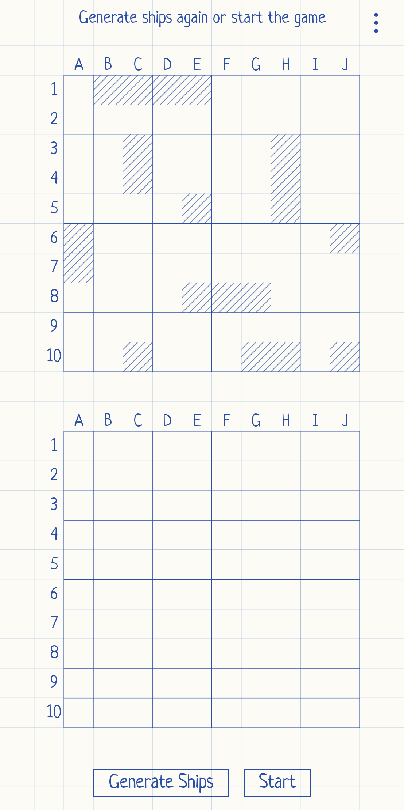
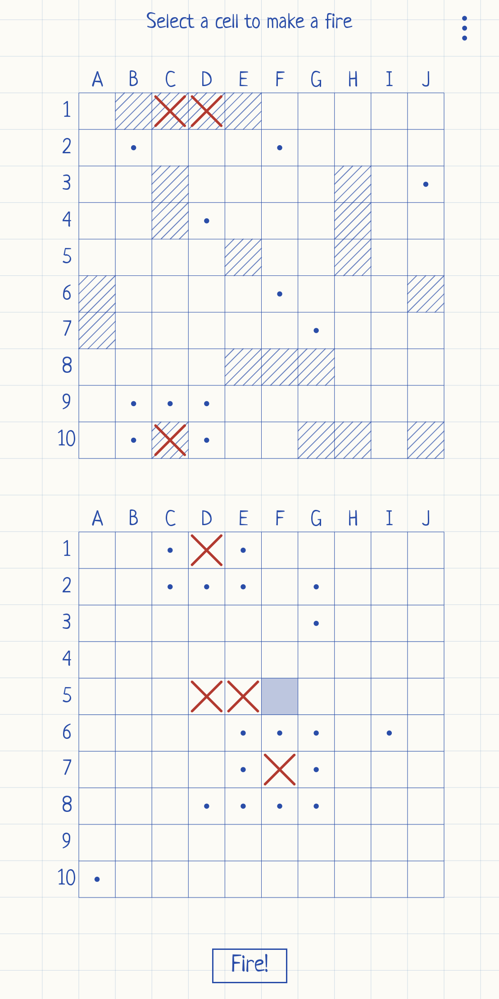
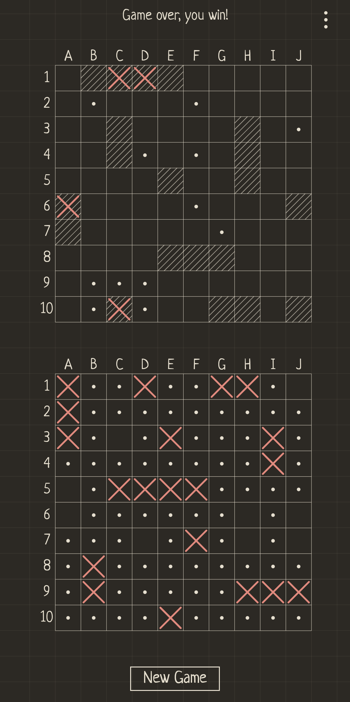
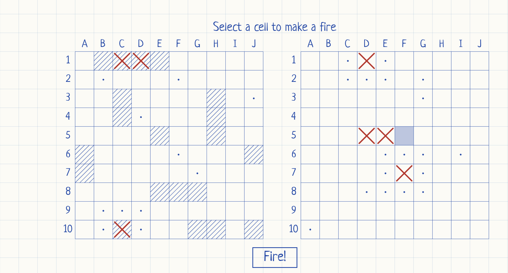

# SeaBattle
Sea Battle - a classic Battleship 2D game for Android, written in Kotlin with Jetpack Compose and Coroutines.


[Play Market](https://play.google.com/store/apps/details?id=com.avs.sea.battle) <b>50K+ downloads</b>

[How to play](https://youtu.be/ZrbtILJjqpU)

<p align="center">
  
  
  
</p>
<p align="center">
  
</p>

<h3> Features </h3>

<ul>
  <li>Hand-drawn notebook look with light and dark themes</li>
  <li>Portrait and landscape layouts</li>
  <li>Computer opponent that hunts down wounded ships</li>
  <li>English, Ukrainian and Russian localization</li>
</ul>

<h3> Active branches: </h3>

<ul><b> dev </b> - contains stable implementation of main functionality and tests.</ul>
<ul><b> master </b> - released versions.</ul>

<h3> Architecture approach </h3>

Single-Activity MVVM. `MainViewModel` owns the game state and exposes it as a single `StateFlow<GameUiState>`; the Compose UI observes it and draws both boards on Canvas.

<ul>
  <li><b>battle_field</b> - pure Kotlin game model: the 10×10 grid, ship placement and shot handling</li>
  <li><b>main</b> - <code>MainViewModel</code> runs the turns, <code>ShotManager</code> is the computer's AI</li>
  <li><b>ui</b> - Compose screens, the notebook-paper background and the board grid</li>
</ul>

<h3> Main libraries used: </h3>

<b> Jetpack Compose, Material 3 </b> - UI<br>
<b> Coroutines, StateFlow </b> - pacing the computer's moves and delivering state to the UI<br>
<b> Lifecycle ViewModel </b> - keeping game state across configuration changes<br>
<b> Play In-App Review </b> - asking for a rating after a win<br>
<b> JUnit 4, Mockito, Compose UI Test </b> - tests<br>

<h3> Build </h3>

```bash
./gradlew assembleDebug        # build debug APK
./gradlew testDebugUnitTest    # unit tests
./gradlew connectedAndroidTest # instrumented tests (device/emulator)
```
